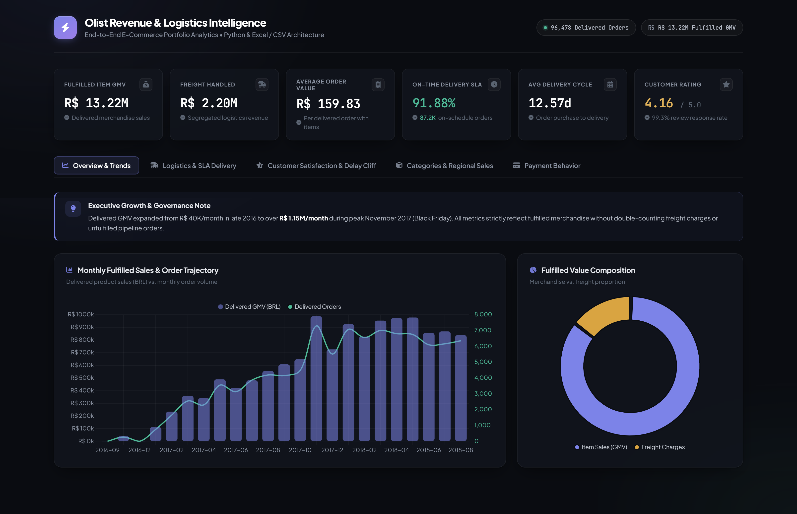
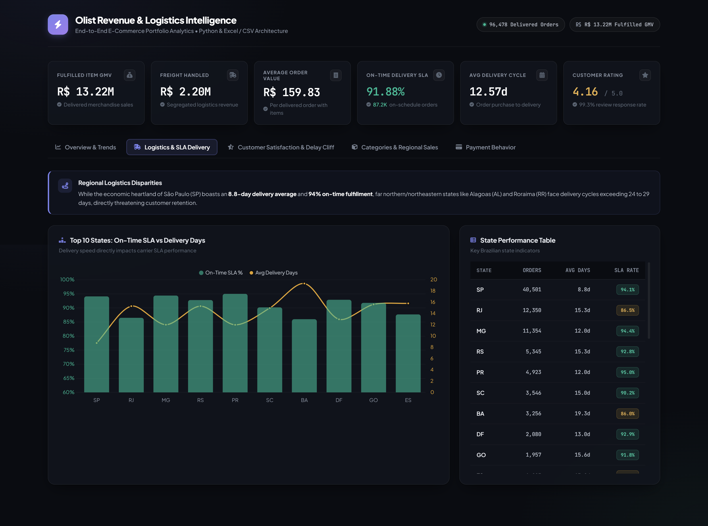
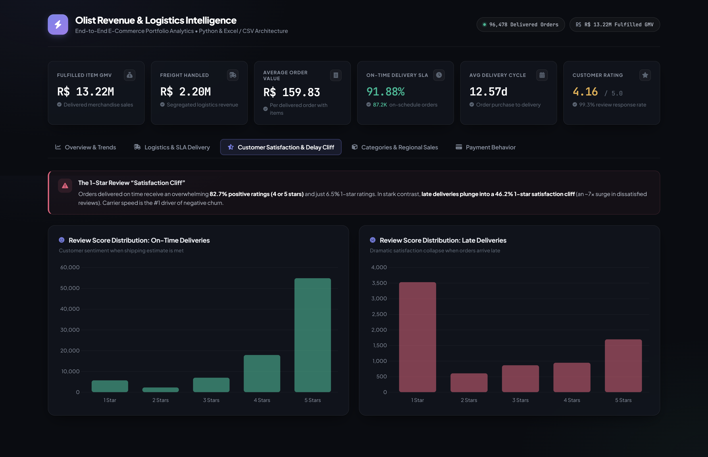
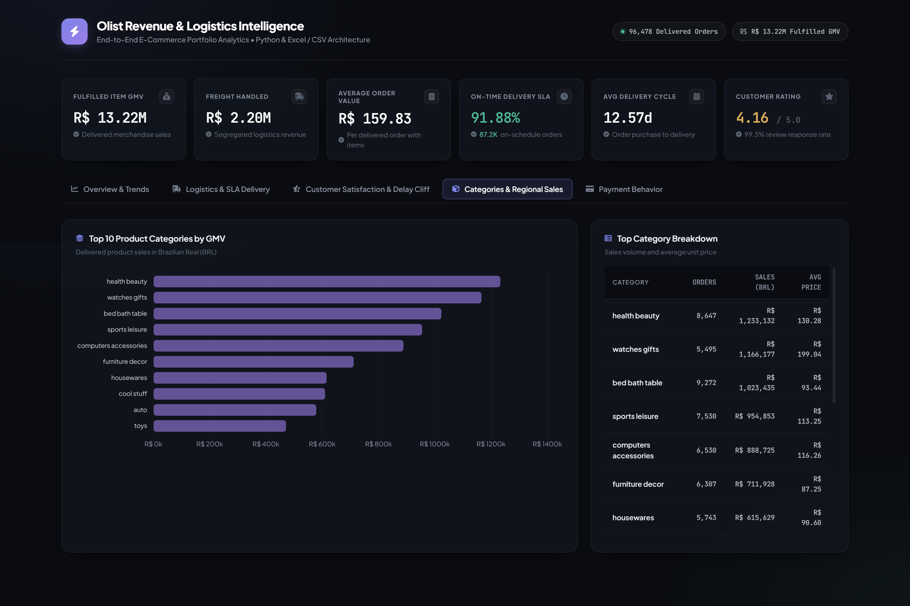
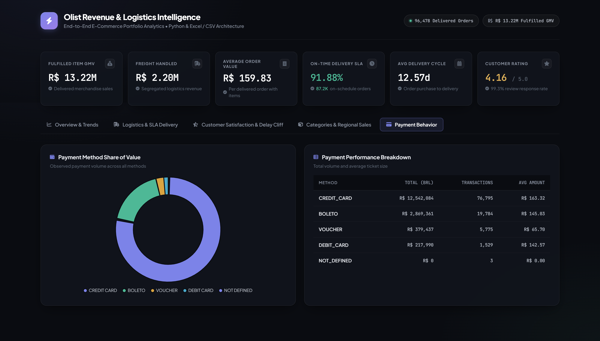

# Olist E-Commerce Revenue & Delivery Intelligence Pipeline

> **End-to-end Python, Excel, and Interactive Web Analytics pipeline evaluating R$ 13.2M+ in marketplace sales, logistics SLAs, and customer retention metrics across 96K+ orders.**

[](https://www.python.org/)
[](https://pandas.pydata.org/)
[](https://jupyter.org/)
[](https://developer.mozilla.org/en-US/docs/Web/HTML)
[](https://www.chartjs.org/)
[](https://office.live.com/)

---

## 📌 Executive Summary

This portfolio project analyzes transactional order activity from **Olist**, Brazil's largest department store marketplace, covering 2016 through 2018. The objective is to evaluate fulfilled revenue growth, regional sales distribution, category performance, and the direct correlation between logistics delivery delays and customer satisfaction.

The project is built on an **end-to-end multi-tier architecture**:

1. **Automated Python Batch Pipeline (`scripts/run_analysis.py`):** Ingests and cleans 8 relational CSV tables (~500,000+ records), enforces data hygiene, reconciles payments, and exports summary analytics in under 10 seconds.
2. **Exploratory Data Analysis (`notebooks/eda_exploration.ipynb`):** Step-by-step statistical narrative, distribution modeling, and visualization in Jupyter.
3. **Interactive Executive Dashboard (`deliverables/dashboard.html`):** Modern, responsive, zero-dependency browser dashboard powered by Chart.js.
4. **Excel-Ready Summary Artifacts (`reports/`):** Clean, aggregated CSV exports ready for Pivot Tables and stakeholder presentation.

---

## 📊 Key Business & Resume Numbers

| Metric                         |        Value         | Business Context                                                      |
| :----------------------------- | :------------------: | :-------------------------------------------------------------------- |
| **Fulfilled Item Sales (GMV)** | **R$ 13,221,498.11** | Total product sales for delivered orders with item records            |
| **Freight Charges Handled**    | **R$ 2,198,275.64**  | Logistics fees tracked and reported separately from merchandise sales |
| **Fulfilled Order Value**      | **R$ 15,419,773.75** | Total fulfilled value (product sales + freight charges)               |
| **Delivered Orders**           |      **96,478**      | Completed order volume out of 99,441 total lifecycle orders           |
| **Average Order Value (AOV)**  |    **R$ 159.83**     | Average order value across delivered orders with items                |
| **On-Time Delivery Rate**      |      **91.88%**      | 87,290 on-time orders across 96,281 strictly verified deliveries      |
| **Average Delivery Time**      |    **12.57 days**    | Ranging from 8.8 days (São Paulo) to 29.4 days (Roraima)              |
| **Average Review Score**       |   **4.16 / 5.00**    | Across 99.3% review coverage on delivered orders                      |
| **Top Category**               | **Health & Beauty**  | **R$ 1.23M** item sales across 8,647 orders                           |
| **Top Regional Market**        |  **São Paulo (SP)**  | **R$ 5.07M (38.3% of GMV)** across 40,501 orders                      |

---

## 🖥️ Interactive Dashboard Showcase

The offline interactive dashboard (`deliverables/dashboard.html`) brings all findings to life:

### 1. Executive Overview & Monthly Growth Trajectory

_Dual-axis monthly sales trajectory (GMV vs. order volume) highlighting the November 2017 Black Friday peak (R$ 1.15M+), alongside the merchandise vs. freight value split._



---

### 2. Regional Logistics Disparities & Delivery SLA

_Comparison of On-Time SLA % vs. average delivery cycle across Brazilian states, highlighting high logistics efficiency in the Southeast (SP: 8.8d, 94.1% SLA) vs. significant delays in the North/Northeast._



---

### 3. Customer Satisfaction & The 1-Star Review "Satisfaction Cliff"

_Empirical proof that shipping delays destroy customer retention: on-time deliveries yield 82.7% positive ratings (4-5 stars), whereas late deliveries trigger a **46.2% 1-star review cliff** (an ~7x surge in severe dissatisfaction)._



---

### 4. Category & Product Revenue Distribution

_Delivered sales rankings and average unit selling price across top categories, led by Health & Beauty (R$ 1.23M) and Watches & Gifts (R$ 1.17M)._



---

### 5. Payment Behavior & Ticket Size Analysis

_Breakdown of marketplace transaction volume: Credit Card dominance (~78%) vs. Boleto cash vouchers (~18%), including ticket size averages and data hygiene auditing._



---

## 🛠️ Technology Stack

| Layer                          | Tools & Technologies                                    | Role in Project                                                                                  |
| :----------------------------- | :------------------------------------------------------ | :----------------------------------------------------------------------------------------------- |
| **Data Processing & Pipeline** | `Python 3.9+`, `Pandas`, `NumPy`                        | Vectorized data cleaning, date arithmetic, financial reconciliation, and KPI aggregation.        |
| **Exploratory Data Analysis**  | `Jupyter Notebook`, `Matplotlib`, `Seaborn`             | In-depth EDA, hypothesis testing, distribution plots, and correlation studies.                   |
| **Interactive Dashboard**      | `HTML5`, `CSS3 (Vanilla)`, `JavaScript`, `Chart.js 4.4` | Executive dashboard with dark-slate glassmorphism UI, tabbed navigation, and interactive charts. |
| **Business Reporting**         | `Microsoft Excel (CSV Exports)`                         | Pivot table exploration, summary scorecards, and executive-ready reporting.                      |
| **Deployment & Versioning**    | `Git`, `GitHub Pages`                                   | Version control, issue tracking, and instant web dashboard hosting with zero server overhead.    |

---

## 📂 Dataset Architecture & Relational Model

The raw data consists of **8 relational CSV files** (+ 1 geolocation reference) in `data/raw/` totaling **500,000+ records**:

```text
        [olist_customers]
                │ (customer_id)
                ▼
        [olist_orders] ◄──────── (order_id) ────────► [olist_order_payments]
                │
                ├─────────────── (order_id) ────────► [olist_order_reviews]
                │
                ▼ (order_id)
     [olist_order_items]
        │             │
        │(product_id) │(seller_id)
        ▼             ▼
 [olist_products]   [olist_sellers]
        │
        ▼ (product_category_name)
 [product_category_name_translation]
```

### Source File Breakdown

| Table                                   |   Rows    | Primary / Foreign Keys                                      | Description                                  |
| :-------------------------------------- | :-------: | :---------------------------------------------------------- | :------------------------------------------- |
| `olist_orders_dataset.csv`              |  99,441   | `order_id` (PK), `customer_id` (FK)                         | Order lifecycle & timestamps                 |
| `olist_order_items_dataset.csv`         |  112,650  | `(order_id, order_item_id)` (PK), `product_id`, `seller_id` | Item pricing and freight values              |
| `olist_order_payments_dataset.csv`      |  103,886  | `order_id` (FK), `payment_sequential`                       | Payment method, installments, and amount     |
| `olist_order_reviews_dataset.csv`       |  99,224   | `(review_id, order_id)` (PK)                                | Customer satisfaction ratings (1–5)          |
| `olist_customers_dataset.csv`           |  99,441   | `customer_id` (PK)                                          | Customer location (state, city, zip)         |
| `olist_products_dataset.csv`            |  32,951   | `product_id` (PK)                                           | Category name, weight, dimensions            |
| `product_category_name_translation.csv` |    71     | `product_category_name` (PK)                                | English category translation lookup          |
| `olist_sellers_dataset.csv`             |   3,095   | `seller_id` (PK)                                            | Seller origins (state, city)                 |
| `olist_geolocation_dataset.csv`         | 1,000,163 | `geolocation_zip_code_prefix`                               | Lat/Long _(isolated due to 261K duplicates)_ |

---

## 📐 Data Governance & Business Rules

- **Fulfilled Item Sales:** `SUM(price)` strictly for orders with status `delivered` and valid item rows.
- **Freight Charges:** `SUM(freight_value)` for the delivered population; reported strictly separate from product revenue to prevent double-counting.
- **Fulfilled Order Value:** Product sales plus freight charges at the order grain.
- **Average Order Value (AOV):** Fulfilled order value divided by distinct delivered orders.
- **Strict Delivery SLA Population:** Delivered orders with verified, chronological lifecycle timestamps (`purchase` ≤ `carrier` ≤ `delivery`). Chronological edge-case anomalies are isolated from SLA denominator.
- **Financial Integrity Note:** No metric is assumed to be net profit or operating margin; data reflects gross marketplace transaction activity.

---

## 🔍 Data Quality & Engineering Safeguards

1. **Composite Key Enforcement:** Resolved multi-order review collisions by validating `(review_id, order_id)` as the unique primary grain.
2. **Duplicate Isolation:** Identified and excluded 261,831 exact duplicate rows in the geolocation dataset to protect reporting accuracy.
3. **Financial Reconciliation:** Detected 376 edge-case orders where recorded payments differed by > BRL 0.01 from item + freight totals; flagged for auditing rather than silently dropped.
4. **Category Mapping:** Identified unmapped product categories and gracefully grouped them under an `"Uncategorized"` bucket.

---

## 🚀 How to Run the Project Locally

### 1. Prerequisites

Ensure you have Python 3.9+ installed:

```powershell
pip install pandas numpy matplotlib seaborn
```

### 2. Run the Automated Pipeline

Execute the Python script to process all raw datasets, validate business logic, and export clean summary tables:

```powershell
python .\scripts\run_analysis.py
```

### 3. Open the Interactive Dashboard

Double-click `deliverables/dashboard.html` to open the executive dashboard directly in Google Chrome, Microsoft Edge, or any modern web browser — **no local web server or build tool required**.

### 4. Explore in Excel

Open any of the generated CSV summaries in `reports/` directly in Microsoft Excel for Pivot Table analysis:

- `monthly_sales_trends.csv` — Monthly revenue trajectory, order counts, and AOV.
- `category_performance.csv` — Sales, item volume, and average freight per category.
- `delivery_performance.csv` — Regional delivery duration, late delivery counts, and on-time rates by state.
- `review_performance.csv` — Score distributions segmented by on-time vs. late delivery.
- `payment_method_performance.csv` — Breakdown of payment volume, transactions, and ticket sizes.

---

## 📈 Strategic Business Recommendations

1. **Regional Fulfillment Hubs in North/Northeast:** States like Alagoas (AL: 76.1% SLA, 24.5-day avg) and Maranhão (MA: 80.3% SLA, 21.6-day avg) suffer severe logistical friction. Establishing localized distribution partnerships or regional micro-fulfillment centers will dramatically cut shipping cycles.
2. **Automated Post-Delay Retention Workflows:** Because delivery delays cause an ~7x surge in 1-star reviews (46.2% vs. 6.5%), implementing an automated tracking trigger that sends apologies and shipping vouchers before the customer receives their order can preempt negative reviews.
3. **High-Margin Category Prioritization:** Categories like **Watches & Gifts** (AOV R$ 199.04) and **Health & Beauty** (AOV R$ 130.28) generate high revenue density with minimal freight overhead relative to bulky goods.
